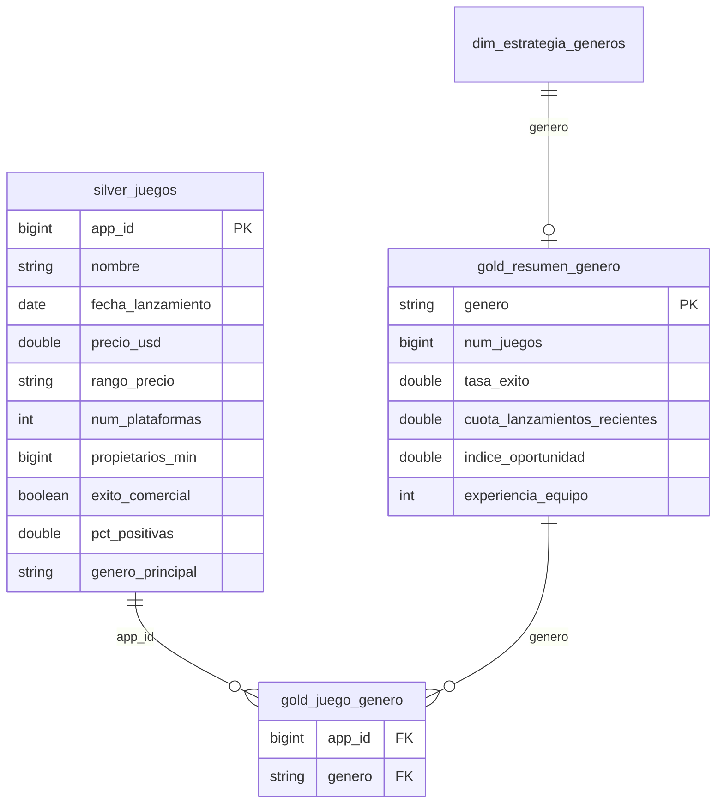
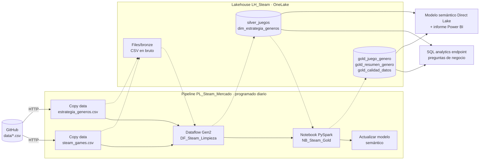

# Guion de laboratorio — Inteligencia de mercado en Steam con Microsoft Fabric

> **Borrador del Entregable 1.** Está redactado como práctica guiada siguiendo la estructura que
> pide el enunciado. Los recuadros **📸 CAPTURA** marcan dónde hay que pegar una captura real de
> Fabric (obligatorio). Las cifras de "Resultado esperado" se han calculado con
> `scripts/02_validar_local.py`, que replica la lógica en local: si en Fabric salen los mismos
> números, el paso está bien hecho.
>
> Para entregar: completa los nombres del equipo, haz las capturas, revisa la redacción y exporta a PDF.

**Equipo:** _Nombre 1_ · _Nombre 2_   **Asignatura:** Cloud Computing · Curso 2026-2027

---

## 1. Introducción y caso de uso

### 1.1 Organización
**Nébula Games** (empresa ficticia) es un estudio y editora independiente de videojuegos con
15 empleados que publica exclusivamente en **Steam**. Ha lanzado cuatro juegos pequeños de aventura
y estrategia y prepara su **plan de producción para 2027-2028**, con presupuesto para **un solo
proyecto grande** (≈ 300.000–550.000 €).

### 1.2 Problema
Steam está saturado: en 2025 se publicaron **≈ 24.700 juegos** (frente a ≈ 7.000 en 2019) y
**solo el 7 %** de los juegos supera los 100.000 propietarios. Hoy el comité decide el género,
el precio y las plataformas del próximo juego por intuición. Equivocarse supone perder 1–2 años
de trabajo del estudio.

**Necesidad:** disponer de una herramienta que, con datos de todo el catálogo de Steam y los datos
internos del estudio, indique *dónde hay más probabilidad de éxito con menos competencia* y que se
actualice sola cuando llegue un nuevo volcado de datos.

### 1.3 Usuarios y decisiones

| Usuario | Decisión que toma con la solución |
|---|---|
| Dirección general (CEO) | En qué género invertir el presupuesto del próximo proyecto |
| Productor / comité de producto | Si el proyecto es viable con la experiencia y plazos del equipo |
| Marketing | Precio de lanzamiento y mes de salida |
| Dirección técnica | Si merece la pena portar a Mac y Linux |

### 1.4 Objetivos de la solución
1. Centralizar en la nube el catálogo de Steam (≈ 126.000 apps) y los datos internos.
2. Limpiar automáticamente los datos (duplicados, nulos, formatos, valores fuera de rango).
3. Calcular indicadores de éxito, satisfacción y saturación por género, precio y plataforma.
4. Ofrecer un cuadro de mando interactivo que responda a las preguntas de negocio.
5. Automatizar todo el proceso con un pipeline programado.

### 1.5 Preguntas de negocio

| # | Pregunta | Dónde se responde |
|---|---|---|
| P1 | ¿Qué géneros combinan mayor tasa de éxito con menor saturación, y cuáles son viables para nuestro equipo? | `gold_resumen_genero`, página 2 del informe |
| P2 | ¿Qué rango de precio se asocia a más éxito comercial y mejores reseñas? | `silver_juegos`, página 1 |
| P3 | ¿Compensa publicar también en Mac y/o Linux? | `silver_juegos`, página 1 |
| P4 | ¿Cómo evoluciona la saturación del mercado y qué meses son mejores para lanzar? | `silver_juegos`, página 1 |

### 1.6 ¿Por qué cloud?
- El volumen (≈ 30 MB de CSV, 126.000 filas, 24 columnas) crece cada año y se actualiza con frecuencia.
- Fabric reúne ingesta, almacenamiento, transformación y BI en un solo servicio SaaS: no hay que
  instalar ni mantener servidores, Spark ni Power BI Report Server.
- El comité consulta el cuadro de mando desde el navegador, sin copias de Excel desactualizadas.
- Pago por capacidad: un estudio de 15 personas no puede permitirse infraestructura propia de datos.

---

## 2. Descripción de los datos

### 2.1 Fuentes

| Fichero | Origen | Tipo | Filas | Descripción |
|---|---|---|---|---|
| `data/steam_games.csv` | *Steam Games Dataset* (Kaggle, recopilado de la API de Steam y SteamSpy) | Público + problemas de calidad inyectados | 127.742 | Una fila por app de Steam |
| `data/estrategia_generos.csv` | Generado por el equipo (`scripts/01_preparar_dataset.py`) | Sintético | 12 | Datos internos de Nébula Games por género |
| `data/registro_problemas_inyectados.csv` | Generado por el script | Trazabilidad | 20.257 | Qué valor se alteró, en qué columna y de qué tipo |

El dataset original (`games.csv`, 400 MB) incluye descripciones, URLs de capturas y vídeos que no
aportan al caso de uso. El script `01_preparar_dataset.py` selecciona 24 columnas (≈ 29 MB).

### 2.2 Variables principales de `steam_games.csv`

| Columna | Tipo | Descripción |
|---|---|---|
| `AppID` | entero | Identificador de Steam (clave) |
| `Name` | texto | Nombre del juego |
| `Release date` | texto | Fecha de lanzamiento (`Aug 1, 2023`) |
| `Estimated owners` | texto | Rango de propietarios estimado (`20000 - 50000`) |
| `Price` | decimal | Precio en USD |
| `Windows`, `Mac`, `Linux` | booleano | Plataformas soportadas |
| `Positive`, `Negative` | entero | Número de reseñas positivas / negativas |
| `Metacritic score`, `User score` | entero | Puntuaciones (0 = sin puntuación) |
| `Average/Median playtime forever` | entero | Minutos jugados |
| `Developers`, `Publishers` | texto | Desarrolladora y editora |
| `Genres` | texto | Lista de géneros separados por comas |
| `Supported languages` | texto | Lista de idiomas (`['English', 'French']`) |

### 2.3 Variables de `estrategia_generos.csv` (sintético)

| Columna | Descripción |
|---|---|
| `genero` | Género de Steam (clave de cruce) |
| `coste_desarrollo_eur` | Coste medio estimado de desarrollo para el estudio |
| `meses_desarrollo` | Duración estimada del desarrollo |
| `experiencia_equipo` | Experiencia del equipo en el género (1 = ninguna, 5 = experto) |
| `prioridad_estrategica` | Prioridad fijada por dirección (Alta / Media / Baja) |

### 2.4 Problemas de calidad de datos

Además de los defectos **reales** del dataset, el script inyecta problemas de forma reproducible
(semilla 2627) para demostrar su tratamiento:

| Problema | Real / inyectado | Filas afectadas | Tratamiento (paso del Dataflow) |
|---|---|---|---|
| Cabecera con dos columnas fusionadas (`DiscountDLC count`) | Real | todo el fichero | Corregido en el script de preparación |
| Registros duplicados | Inyectado (1,5 %) | 1.887 | Quitar duplicados por `app_id` (paso 6) |
| `Name` nulo | Inyectado | 255 | Eliminar fila (paso 4) |
| `Price` nulo | Inyectado (1 %) | 1.286 | Marcar `estado_precio = "Nulo"` (paso 11) |
| `Price` negativo o > 1000 $ | Inyectado | 380 | Marcar "Fuera de rango" y dejar nulo (paso 11) |
| Fechas en formato ISO `2023-08-01` | Inyectado (3 %) | 3.837 | Parseo con varios formatos (paso 7) |
| Fechas posteriores a 2026 | Inyectado | 126 | Filtrar (paso 8) |
| Booleanos `TRUE/true/1/yes/Y` | Inyectado (5 %) | 12.469 | Normalizar a lógico (paso 12) |
| Espacios sobrantes en editores | Inyectado (2 %) | — | `Text.Trim` (paso 3) |
| Puntuaciones `0` que significan "sin dato" | Real | mayoría | Sustituir por nulo (paso 13) |
| Rango de propietarios como texto | Real | todas | Separar en mín./máx./medio (paso 14) |
| `Genres` nulo | Real | ≈ 8.400 | "Sin género" (paso 9) |
| Software que no es juego (Utilities, Video Production…) | Real | ≈ 1.500 | Filtrar (paso 10) |
| `" casual "` en el fichero interno | Inyectado | 1 | Trim + mayúsculas (consulta `estrategia_generos`) |

### 2.5 Modelo de datos resultante

**Definiciones clave**
- **Éxito comercial:** `propietarios_min ≥ 100.000` (el juego está como mínimo en el rango 100k–200k).
- **% reseñas positivas:** `positivas / (positivas + negativas)`, solo si hay ≥ 10 reseñas.
- **Índice de oportunidad (por género):** `tasa de éxito / cuota de lanzamientos 2023-2025`.
  Un valor alto indica mucho éxito con relativamente poca competencia reciente.

---

## 3. Arquitectura propuesta

Se sigue una **arquitectura medallion**:

| Capa | Dónde | Contenido |
|---|---|---|
| Bronze | `LH_Steam/Files/bronze` | CSV tal cual llegan (copia fiel del origen, auditable) |
| Silver | Tablas Delta `silver_juegos`, `dim_estrategia_generos` | Datos limpios, tipados y cruzados |
| Gold | Tablas Delta `gold_*` | Agregados listos para negocio y control de calidad |

**Justificación de los componentes**

| Componente | Por qué |
|---|---|
| **Lakehouse** | Guarda a la vez ficheros (bronze) y tablas Delta (silver/gold) en OneLake; expone un endpoint SQL y permite Direct Lake en Power BI sin copiar datos. |
| **Data Pipeline** | Orquesta el proceso completo en orden, con dependencias, reintentos, programación y monitorización. |
| **Dataflow Gen2** | Transformaciones de limpieza con Power Query (low-code, cada paso queda documentado y es fácil de revisar). |
| **Notebook PySpark** | Operaciones que en Power Query son pesadas o poco naturales: `explode` de la lista de géneros, agregados con percentiles, comparación bronze vs. silver. |
| **SQL analytics endpoint** | Responder a las preguntas de negocio con T-SQL sin mover datos. |
| **Power BI (Direct Lake)** | Cuadro de mando interactivo que lee directamente las tablas Delta, siempre actualizado. |

---

## 4. Desarrollo paso a paso

### Paso 0. Preparación (fuera de Fabric)

1. Ejecutar en local `python scripts/01_preparar_dataset.py games.csv data`
   (ya está hecho: los CSV resultantes están en la carpeta `data/` del repositorio).
2. Subir los CSV a GitHub (repositorio público) para que el pipeline los descargue por HTTP.
   URL de cada fichero: `https://raw.githubusercontent.com/ofernandezr29/steam-fabric-mercado/main/data/<fichero>.csv`

**Resultado esperado:** `steam_games.csv` (127.742 filas, 28,7 MB) y `estrategia_generos.csv` (12 filas).

### Paso 1. Crear el área de trabajo

1. Entrar en <https://app.fabric.microsoft.com> con la cuenta de la universidad.
2. Menú lateral **Áreas de trabajo → + Nueva área de trabajo**.
3. Nombre: `WS_Steam_Mercado`. En **Avanzado → Modo de licencia**, elegir **Prueba (Trial)** o la
   capacidad Fabric de la universidad.
4. **Aplicar**.

> 📸 **CAPTURA 1:** panel de creación del área de trabajo con el modo de licencia.

**Resultado esperado:** área de trabajo vacía con el icono de diamante (capacidad Fabric).

### Paso 2. Crear el Lakehouse

1. Dentro del área de trabajo: **+ Nuevo elemento → Lakehouse**.
2. Nombre: `LH_Steam`. Dejar **desmarcada** la opción *Lakehouse schemas* (así las tablas se
   llaman directamente `silver_juegos`, etc.). **Crear**.
3. En el explorador, sobre **Files → ··· → Nueva subcarpeta** → `bronze`.

> 📸 **CAPTURA 2:** Lakehouse con las secciones *Tables* y *Files/bronze*.

**Resultado esperado:** Lakehouse vacío con la carpeta `Files/bronze`. Fabric crea automáticamente
el *SQL analytics endpoint* `LH_Steam`.

### Paso 3. Crear el Dataflow Gen2 (`DF_Steam_Limpieza`)

> Antes de crear el dataflow hay que tener los CSV en `Files/bronze`. La primera vez, súbelos a mano
> (**Files/bronze → ··· → Cargar → Cargar archivos**) o crea primero el pipeline (paso 4) solo con
> las dos actividades de copia y ejecútalo.

1. **+ Nuevo elemento → Dataflow Gen2**. Nombre `DF_Steam_Limpieza`.
2. **Consulta 1 – `estrategia_generos`:**
   1. **Obtener datos → Lakehouse → LH_Steam → Files → bronze → `estrategia_generos.csv`**.
      Fabric crea los pasos de navegación.
   2. Renombrar la consulta a `estrategia_generos` (panel *Configuración de consulta → Nombre*).
   3. **Inicio → Editor avanzado.** Pegar el contenido de `fabric/dataflow/01_estrategia_generos.pq`,
      sustituyendo la línea `Binario = Web.Contents(...)` por los pasos de navegación que había
      generado Fabric (el último paso de navegación debe llamarse `Binario` y devolver el fichero).
      *(Alternativa rápida: dejar `Web.Contents` con la URL de GitHub.)*
3. **Consulta 2 – `silver_juegos`:** igual, con `steam_games.csv` y
   `fabric/dataflow/02_silver_juegos.pq`.
4. Revisar en la vista **Diagrama** que `silver_juegos` depende de `estrategia_generos` (cruce).

> 📸 **CAPTURA 3:** Editor avanzado con el código M.
> 📸 **CAPTURA 4:** lista de **Pasos aplicados** de `silver_juegos`.
> 📸 **CAPTURA 5:** vista Diagrama con las dos consultas y el cruce.

**Transformaciones y su justificación** (numeradas como en el código):

| Paso | Transformación | Por qué es necesaria |
|---|---|---|
| 2 | Renombrar columnas a español/snake_case | Nombres sin espacios, compatibles con Delta y SQL |
| 3 | Trim y `""` → null | Los editores con espacios se contarían como editores distintos |
| 4 | Eliminar filas sin nombre | Un juego sin nombre no es identificable en el informe |
| 5 | Tipos numéricos con cultura en-US | El CSV usa punto decimal; con la cultura española 5.24 sería 524 |
| 6 | Quitar duplicados por `app_id` | Los duplicados inflarían todos los recuentos y KPIs |
| 7 | Fecha con 3 formatos | Origen mezcla `Aug 1, 2023`, `2023-08-01` y `Aug 2023` |
| 8 | Filtrar fechas nulas o > 2026 | Fechas imposibles (fuera de rango) distorsionan la serie temporal |
| 9 | Géneros nulos → "Sin género" y `genero_principal` | Permite agrupar; Indie/Early Access/F2P no describen el tipo de juego |
| 10 | Quitar software (Utilities, Video Production…) | El caso de uso es de videojuegos |
| 11 | `estado_precio`, `precio_usd`, `rango_precio` | Precios nulos/fuera de rango no deben entrar en medias; se conservan las filas para el resto de análisis |
| 12 | Booleanos normalizados | `TRUE`, `1`, `yes`… significan lo mismo |
| 13 | Metacritic/User score 0 → null | 0 significa "sin puntuación", no un 0 real |
| 14 | Propietarios mín./máx./medio y `exito_comercial` | El rango de texto no se puede agregar |
| 15 | `total_resenas`, `pct_positivas` | Métrica de satisfacción; con < 10 reseñas no es fiable |
| 16 | Año, mes, nº de idiomas | Análisis temporal (P4) |
| 17 | **Cruce con `estrategia_generos`** | Combina datos de mercado con datos internos (viabilidad) |
| 18 | Selección y tipos finales | El destino Lakehouse exige tipos definidos |

5. **Destino de datos.** Seleccionar `silver_juegos` → abajo a la derecha **Destino de datos → +
   → Lakehouse** → LH_Steam → **Nueva tabla** `silver_juegos` → Método de actualización
   **Reemplazar** → comprobar la asignación de columnas → **Guardar configuración**.
   Repetir con `estrategia_generos` → nueva tabla `dim_estrategia_generos` (Reemplazar).
6. **Guardar y ejecutar** (o **Publicar**). Esperar a que termine la actualización.

> 📸 **CAPTURA 6:** configuración del destino de datos (método Reemplazar y asignación de columnas).
> 📸 **CAPTURA 7:** historial de actualización correcto y tablas nuevas en el Lakehouse.

**Resultado esperado** (recuentos tras cada paso):

| Etapa | Filas |
|---|---|
| CSV bronze | 127.742 |
| Tras eliminar nombres nulos | 127.487 |
| Tras eliminar duplicados | 125.603 |
| Tras filtrar fechas | 125.478 |
| Tras quitar software → **`silver_juegos`** | **123.919** |

`estado_precio`: OK 122.311 · Nulo 1.240 · Fuera de rango 368.

### Paso 4. Notebook PySpark (`NB_Steam_Gold`)

1. **+ Nuevo elemento → Importar notebook** (o en el área de trabajo **Importar → Notebook →
   Desde este equipo**) y seleccionar `fabric/notebooks/NB_Steam_Gold.ipynb`.
2. Abrirlo, en el panel **Explorador → Agregar lakehouse → Lakehouse existente → LH_Steam**
   (queda como lakehouse predeterminado).
3. Comprobar que la segunda celda está marcada como **celda de parámetros**
   (··· de la celda → *Alternar celda de parámetros*).
4. **Ejecutar todo**.

> 📸 **CAPTURA 8:** salida de la celda del resumen por género.
> 📸 **CAPTURA 9:** tabla `gold_calidad_datos`.

**Resultado esperado:** tablas `gold_juego_genero`, `gold_resumen_genero` (12 géneros con ≥ 500
juegos) y `gold_calidad_datos` con estos valores:

| Métrica | Valor |
|---|---|
| Filas en bronze | 127.742 |
| Registros duplicados | 1.887 |
| Juegos sin nombre | 255 |
| Precio nulo | 1.286 |
| Precio fuera de rango | 380 |
| Fecha en formato ISO | 3.837 |
| Fecha posterior a 2026 | 126 |
| Booleano Mac/Linux mal escrito | 12.469 |
| Filas en silver | 123.919 |

### Paso 5. Pipeline (`PL_Steam_Mercado`)

1. **+ Nuevo elemento → Canalización de datos (Data pipeline)**. Nombre `PL_Steam_Mercado`.
2. **Actividad 1 – Copiar datos** (`Copy_SteamGames`):
   - *Origen:* **Conexión → Nueva → HTTP**. URL base `https://raw.githubusercontent.com/`,
     autenticación **Anónima**. URL relativa: `ofernandezr29/steam-fabric-mercado/main/data/steam_games.csv`.
     Formato de archivo: **Binario**.
   - *Destino:* **Lakehouse → LH_Steam → Files**, ruta `bronze`, nombre `steam_games.csv`,
     formato **Binario**.
3. **Actividad 2 – Copiar datos** (`Copy_Estrategia`): igual con `estrategia_generos.csv`.
4. **Actividad 3 – Flujo de datos** (`Dataflow_Limpieza`): seleccionar `DF_Steam_Limpieza`.
   Unir con flecha **Al completarse correctamente** desde las dos copias.
5. **Actividad 4 – Notebook** (`Notebook_Gold`): seleccionar `NB_Steam_Gold`. En *Parámetros base*
   se pueden pasar `anio_ini_recientes` / `anio_fin_recientes`. Unir desde el dataflow (éxito).
6. **Actividad 5 – Actualizar modelo semántico** (`Refresh_Modelo`): seleccionar `SM_Steam_Mercado`
   (crearlo antes, paso 7). Unir desde el notebook (éxito).
7. *(Opcional)* Actividad **Outlook de Office 365 / Teams** unida con **Al producirse un error**
   desde el dataflow y el notebook, para avisar si falla.
8. **Validar → Guardar → Ejecutar**.
9. **Programar:** Inicio → **Programación** → diaria a las 06:00 → Aplicar.

> 📸 **CAPTURA 10:** lienzo del pipeline con las actividades conectadas.
> 📸 **CAPTURA 11:** configuración del origen HTTP de la copia.
> 📸 **CAPTURA 12:** ejecución correcta (todas las actividades en verde) en la pestaña *Salida*.
> 📸 **CAPTURA 13:** programación configurada.

**Resultado esperado:** ejecución completa en unos minutos; las tablas del Lakehouse se recrean con
los mismos recuentos del paso 3 y 4.

### Paso 6. Consultas SQL (preguntas de negocio)

1. En el Lakehouse, desplegable superior derecho **Lakehouse → SQL analytics endpoint**.
2. **Nueva consulta SQL** y pegar `fabric/sql/preguntas_negocio.sql` (ejecutar cada bloque).

> 📸 **CAPTURA 14–17:** resultado de cada consulta P1–P4.

**Resultados esperados**

**P1 – Géneros** (ordenados por índice de oportunidad)

| Género | Juegos | Tasa éxito | Cuota lanzamientos 23-25 | Índice | Experiencia equipo | Prioridad |
|---|---|---|---|---|---|---|
| Massively Multiplayer | 2.585 | 17,6 % | 1,9 % | 9,40 | 1 | Baja |
| Racing | 4.144 | 7,1 % | 3,2 % | 2,25 | 1 | Baja |
| Sports | 4.941 | 6,5 % | 3,5 % | 1,83 | 1 | Baja |
| Free To Play | 12.440 | 9,0 % | 11,8 % | 0,76 | 2 | Media |
| **RPG** | 21.503 | 10,2 % | 17,7 % | **0,58** | 3 | **Alta** |
| **Strategy** | 22.993 | 9,7 % | 18,0 % | **0,54** | 4 | **Alta** |
| Early Access | 11.342 | 4,5 % | 9,7 % | 0,47 | 3 | Media |
| Simulation | 24.835 | 8,0 % | 20,6 % | 0,39 | 3 | Media |
| Action | 47.198 | 9,0 % | 34,8 % | 0,26 | 4 | Media |
| Adventure | 46.158 | 7,9 % | 35,7 % | 0,22 | 5 | Alta |
| Casual | 51.526 | 4,3 % | 41,4 % | 0,10 | 4 | Media |
| Indie | 82.558 | 6,4 % | 62,6 % | 0,10 | 5 | Media |

*Interpretación:* MMO, Racing y Sports tienen el mayor índice, pero el cruce con los datos internos
muestra que el equipo no tiene experiencia y su coste (hasta 1,5 M€ y 36 meses en MMO) queda fuera
de presupuesto. **Strategy** (experiencia 4, 350.000 €, 18 meses) y **RPG** son las opciones con
mejor equilibrio oportunidad/viabilidad. Adventure, el género actual del estudio, está muy saturado.

**P2 – Precio**

| Rango | Juegos | Tasa éxito | % positivas |
|---|---|---|---|
| Gratis | 25.727 | 5,7 % | 75,3 % |
| < 5 $ | 65.264 | 6,5 % | 76,8 % |
| 5–9,99 $ | 19.576 | 8,1 % | 79,8 % |
| 10–19,99 $ | 9.408 | 10,4 % | 79,2 % |
| 20–39,99 $ | 1.661 | 16,9 % | 77,5 % |
| ≥ 40 $ | 675 | 6,7 % | 61,2 % |

*Interpretación:* la tasa de éxito crece con el precio hasta 20–39,99 $ (juegos con más
producción); por encima de 40 $ cae el éxito y se desploman las reseñas. Recomendación: 15–25 $.

**P3 – Plataformas**

| Plataformas | Juegos | Tasa éxito | % positivas |
|---|---|---|---|
| 1 | 98.029 | 5,8 % | 76,1 % |
| 2 | 14.469 | 9,8 % | 80,9 % |
| 3 (Win+Mac+Linux) | 11.421 | 14,5 % | 80,1 % |

*Interpretación:* los juegos multiplataforma tienen 2,5 veces más tasa de éxito. Es correlación, no
causalidad (los estudios con más recursos portan más), pero apoya presupuestar el port.

**P4 – Saturación y estacionalidad**
- Lanzamientos por año: 2019: 7.060 · 2021: 10.910 · 2023: 14.423 · 2024: 19.825 · **2025: 24.699**.
- Tasa de éxito por mes (2015-2024): máxima en **abril (8,2 %), septiembre (8,1 %) y marzo (8,0 %)**;
  mínima en **diciembre (5,9 %)** y noviembre (6,5 %), cuando compiten los grandes lanzamientos.

### Paso 7. Modelo semántico y cuadro de mando Power BI

1. En el Lakehouse: **Nuevo modelo semántico**. Nombre `SM_Steam_Mercado`. Seleccionar
   `silver_juegos`, `gold_juego_genero`, `gold_resumen_genero`, `gold_calidad_datos` → **Confirmar**.
   (Modo **Direct Lake**: lee las tablas Delta sin importarlas.)
2. **Abrir modelo de datos** → crear las relaciones arrastrando columnas (ver
   `fabric/powerbi/medidas_dax.md`): `gold_juego_genero[app_id]` → `silver_juegos[app_id]`
   (*:1, filtro **Ambas**) y `gold_juego_genero[genero]` → `gold_resumen_genero[genero]` (*:1).
3. Crear las medidas DAX de `medidas_dax.md` (**Nueva medida**) y darles formato.
4. **Nuevo informe** (desde el modelo). Diseño propuesto:

**Página 1 – "Mercado Steam"**

| Elemento | Visual | Campos | Pregunta |
|---|---|---|---|
| KPI 1 | Tarjeta | `Juegos analizados` | — |
| KPI 2 | Tarjeta | `Tasa de éxito` | — |
| KPI 3 | Tarjeta | `% reseñas positivas` | — |
| KPI 4 | Tarjeta | `Precio medio (de pago)` | — |
| Gráfico 1 | Columnas + línea | Eje `anio_lanzamiento`, columnas `Juegos analizados`, línea `Tasa de éxito` | P4 |
| Gráfico 2 | Barras agrupadas | Eje `rango_precio`, valor `Tasa de éxito` | P2 |
| Gráfico 3 | Columnas agrupadas | Eje `num_plataformas`, valores `Tasa de éxito`, `% reseñas positivas` | P3 |
| Gráfico 4 | Columnas | Eje `mes_lanzamiento`, valor `Tasa de éxito` | P4 |
| Filtro 1 | Segmentación (lista desplegable) | `gold_resumen_genero[genero]` | todas |
| Filtro 2 | Segmentación (control deslizante) | `silver_juegos[anio_lanzamiento]` | todas |
| Filtro 3 | Segmentación | `silver_juegos[prioridad_estrategica]` | P1 |

**Página 2 – "Oportunidad por género"**

| Elemento | Visual | Campos |
|---|---|---|
| Gráfico 5 | Dispersión | X `cuota_lanzamientos_recientes`, Y `tasa_exito`, tamaño `num_juegos`, leyenda `prioridad_estrategica`, detalles `genero` |
| Tabla | Tabla | `genero`, `indice_oportunidad`, `tasa_exito`, `coste_desarrollo_eur`, `meses_desarrollo`, `experiencia_equipo` (con formato condicional de barras en el índice) |

**Página 3 – "Calidad de datos"**: tabla con `gold_calidad_datos` para mostrar al comité que los
datos se han depurado.

Buenas prácticas aplicadas: títulos en cada visual que formulan la pregunta, porcentajes con un
decimal, moneda en $, ejes con unidades, paleta coherente y las segmentaciones agrupadas en una
franja lateral.

> 📸 **CAPTURA 18:** vista de modelo con relaciones.
> 📸 **CAPTURA 19–21:** cada página del informe; **CAPTURA 22:** el informe filtrado por
> "Strategy" para mostrar la interactividad.

### Paso 8. Compartir el área de trabajo con la profesora

Área de trabajo → **Administrar acceso → + Agregar personas o grupos** → correo de la profesora →
rol **Lector** (o *Colaborador* si debe ejecutar el pipeline) → **Agregar**.

> 📸 **CAPTURA 23:** panel de acceso.

---

## 5. Justificación del uso de Microsoft Fabric

**¿Qué aporta una plataforma cloud frente a una solución local?**
Sin servidores que instalar ni mantener; almacenamiento único (OneLake) compartido por todos los
componentes sin copias; escalado del cómputo Spark según la carga; acceso desde cualquier lugar con
control de permisos por área de trabajo; y pago por capacidad en lugar de comprar hardware.

**¿Qué ventajas ofrece el Pipeline frente a ejecutar cada operación a mano?**
Garantiza el orden (no se calcula gold con silver a medio cargar), se programa para que el cuadro de
mando esté al día sin intervención, registra cada ejecución con su duración y errores, permite
reintentos y alertas, y hace el proceso reproducible por cualquier miembro del equipo.

**¿Qué aporta el cuadro de mando a la organización?**
Convierte 126.000 registros en cuatro respuestas accionables (género, precio, plataformas, fecha),
pone en común una única versión de los datos para todo el comité y permite explorar escenarios
(p. ej. filtrar solo géneros de prioridad alta) en segundos.

**¿Cómo evolucionaría con más volumen o más frecuencia?**
- Carga incremental: copiar solo apps nuevas o modificadas y usar `MERGE` en Delta en vez de reemplazar.
- Ingesta directa de la API de Steam con un notebook o un *Eventstream* para precios y jugadores
  concurrentes casi en tiempo real (Real-Time Intelligence / Eventhouse).
- Particionar las tablas por año y mover la limpieza pesada del Dataflow a Spark si el volumen crece mucho.
- Un modelo de ML (p. ej. clasificación con MLflow en Fabric) para predecir la probabilidad de éxito de un concepto de juego.
- Pasar a un Warehouse si se necesitan escrituras T-SQL o muchos usuarios concurrentes.

---

## 6. Conclusiones y limitaciones

**Recomendación para Nébula Games:** desarrollar un juego de **estrategia** (alternativa: RPG),
precio de **15–25 $**, publicado en **Windows, Mac y Linux**, con lanzamiento en **marzo-abril o
septiembre**, evitando noviembre y diciembre.

**Limitaciones:**
- Los propietarios son rangos estimados (SteamSpy), no ventas reales.
- Los juegos de 2025-2026 aún no han tenido tiempo de alcanzar 100.000 propietarios, lo que reduce
  su tasa de éxito; por eso P4b se calcula con 2015-2024.
- Las relaciones observadas son correlaciones, no causas.
- Los datos internos son sintéticos.

---

## Anexo: ficheros del repositorio

| Ruta | Contenido |
|---|---|
| `data/` | Datasets (Entregable 2) |
| `scripts/01_preparar_dataset.py` | Preparación del dataset e inyección de problemas de calidad |
| `scripts/02_validar_local.py` | Réplica local de la lógica para obtener resultados esperados |
| `scripts/03_generar_notebook.py` | Genera el notebook a partir de código legible |
| `fabric/dataflow/*.pq` | Código Power Query M del Dataflow Gen2 |
| `fabric/notebooks/NB_Steam_Gold.ipynb` | Notebook PySpark (Entregable 3) |
| `fabric/sql/preguntas_negocio.sql` | Consultas T-SQL de las preguntas de negocio |
| `fabric/powerbi/medidas_dax.md` | Medidas DAX y relaciones del modelo |
