# Análisis del mercado de videojuegos en Steam con Microsoft Fabric

**Proyecto de Cloud Computing. Curso 2026-2027**

Autores: _Nombre 1_ y _Nombre 2_

Repositorio con los datos y el código: https://github.com/ofernandezr29/steam-fabric-mercado

---

## 1. Introducción y caso de uso

### 1.1 La organización

Para el proyecto hemos planteado el caso de Nébula Games, un estudio independiente de videojuegos
(ficticio) de unas 15 personas que publica sus juegos únicamente en Steam. Hasta ahora ha sacado
cuatro juegos pequeños, sobre todo de aventura y algo de estrategia, y está preparando lo que hará
en 2027-2028. El presupuesto le da para un único proyecto grande, de entre 300.000 y 550.000 euros
aproximadamente.

### 1.2 El problema

El problema es que Steam está cada vez más saturado. Según los datos que hemos usado, en 2019 se
publicaron unos 7.000 juegos y en 2025 casi 25.000, y solo alrededor del 7 % del catálogo llega a
superar los 100.000 propietarios. En un estudio de este tamaño la decisión de qué juego hacer se
suele tomar en una reunión y bastante a ojo, y si sale mal se pierden uno o dos años de trabajo.

Lo que necesita la empresa es poder mirar el catálogo completo de Steam junto con sus propios datos
internos y ver en qué tipo de juego hay más posibilidades de éxito con menos competencia. Además,
interesa que esto se actualice solo cada vez que haya datos nuevos, sin que nadie tenga que repetir
el proceso a mano.

### 1.3 Usuarios y decisiones

Los resultados los usarían principalmente:

- La dirección, para decidir en qué género invertir el presupuesto.
- El productor o el comité de producto, para valorar si el proyecto es viable con la experiencia
  que tiene el equipo y en qué plazo.
- Marketing, para fijar el precio de salida y elegir el mes de lanzamiento.
- El responsable técnico, para decidir si merece la pena sacar el juego también en Mac y Linux.

### 1.4 Objetivos

1. Tener en la nube el catálogo de Steam (unas 126.000 aplicaciones) y los datos internos del estudio.
2. Limpiar los datos de forma automática: duplicados, nulos, formatos distintos y valores imposibles.
3. Calcular indicadores de éxito, valoración de los usuarios y saturación por género, precio y plataforma.
4. Montar un cuadro de mando en Power BI que permita responder a las preguntas de negocio.
5. Automatizar todo el proceso con un pipeline que se ejecute de forma programada.

### 1.5 Preguntas de negocio

Las preguntas que queremos responder son estas:

- **P1.** ¿Qué géneros tienen más tasa de éxito con menos saturación del mercado, y cuáles de ellos
  son viables para el equipo?
- **P2.** ¿Qué rango de precio se asocia a más éxito comercial y mejores reseñas?
- **P3.** ¿Compensa publicar también en Mac y Linux?
- **P4.** ¿Cómo ha evolucionado el número de lanzamientos y qué meses son mejores para lanzar?

### 1.6 Por qué usar una solución cloud

El volumen de datos no es enorme, pero tampoco es pequeño (unas 126.000 filas) y crece cada año.
Con Fabric no hace falta montar ni mantener ningún servidor: el almacenamiento, la transformación,
Spark y Power BI están en el mismo servicio y todo trabaja sobre los mismos datos en OneLake. El
comité puede ver el cuadro de mando desde el navegador sin ir pasándose ficheros Excel, y para una
empresa pequeña tiene más sentido pagar por capacidad que comprar e instalar infraestructura propia.

---

## 2. Descripción de los datos

### 2.1 Origen de los datos

Hemos usado tres ficheros:

| Fichero | Origen | Filas | Contenido |
|---|---|---|---|
| `steam_games.csv` | Steam Games Dataset (Kaggle), obtenido de la API de Steam y de SteamSpy | 127.742 | Una fila por aplicación de Steam |
| `estrategia_generos.csv` | Sintético, generado por nosotros | 12 | Datos internos del estudio por género |
| `registro_problemas_inyectados.csv` | Generado por el script de preparación | 20.257 | Qué valores hemos alterado y en qué columna |

El fichero original de Kaggle (`games.csv`) ocupa unos 400 MB porque incluye las descripciones de
los juegos, enlaces a capturas y vídeos, etc. Como no lo necesitábamos y además GitHub no admite
ficheros de más de 100 MB, preparamos un script en Python (`01_preparar_dataset.py`) que se queda
con 24 columnas. El resultado ocupa unos 29 MB.

Al abrir el fichero original nos encontramos con que la cabecera tiene 39 nombres de columna pero
cada fila tiene 40 valores: las columnas `Discount` y `DLC count` aparecen juntas como
`DiscountDLC count`. Lo corregimos en el mismo script antes de hacer nada más.

### 2.2 Variables principales de steam_games.csv

| Columna | Tipo | Descripción |
|---|---|---|
| AppID | entero | Identificador del juego en Steam |
| Name | texto | Nombre |
| Release date | texto | Fecha de lanzamiento, con formato `Aug 1, 2023` |
| Estimated owners | texto | Rango estimado de propietarios, por ejemplo `20000 - 50000` |
| Price | decimal | Precio en dólares |
| Windows, Mac, Linux | booleano | Plataformas en las que está disponible |
| Positive, Negative | entero | Número de reseñas positivas y negativas |
| Metacritic score, User score | entero | Puntuaciones (un 0 significa que no tiene) |
| Average / Median playtime forever | entero | Minutos de juego medios y medianos |
| Developers, Publishers | texto | Desarrolladora y editora |
| Genres | texto | Lista de géneros separados por comas |
| Supported languages | texto | Lista de idiomas, por ejemplo `['English', 'French']` |

### 2.3 Datos internos (estrategia_generos.csv)

Este fichero simula la información que tendría el propio estudio. Los valores los hemos fijado
nosotros pensando en un estudio pequeño:

| Columna | Descripción |
|---|---|
| genero | Género de Steam, sirve para cruzarlo con el catálogo |
| coste_desarrollo_eur | Coste aproximado de desarrollar un juego de ese género |
| meses_desarrollo | Tiempo de desarrollo estimado |
| experiencia_equipo | Experiencia del equipo en ese género, de 1 (ninguna) a 5 |
| prioridad_estrategica | Prioridad que le da la dirección: Alta, Media o Baja |

### 2.4 Problemas de calidad

El enunciado pide que los datos tengan problemas de calidad para demostrar cómo se tratan. El
dataset ya traía algunos de origen, y otros los añadimos con el script de preparación usando una
semilla fija (2627) para que el resultado sea siempre el mismo. Todo lo que se modifica queda
apuntado en `registro_problemas_inyectados.csv`.

| Problema | Origen | Filas | Cómo se trata en el Dataflow |
|---|---|---|---|
| Registros duplicados | Añadido (1,5 %) | 1.887 | Se quitan duplicados por `app_id` (paso 6) |
| Nombre vacío | Añadido | 255 | Se elimina la fila (paso 4) |
| Precio vacío | Añadido (1 %) | 1.286 | Se marca como "Nulo" en `estado_precio` (paso 11) |
| Precio negativo o mayor de 1000 $ | Añadido | 380 | Se marca como "Fuera de rango" y no se usa en medias (paso 11) |
| Fechas en formato `2023-08-01` | Añadido (3 %) | 3.837 | Se prueban varios formatos de fecha (paso 7) |
| Fechas posteriores a 2026 | Añadido | 126 | Se filtran (paso 8) |
| Booleanos escritos como `TRUE`, `1`, `yes`, `Y`... | Añadido (5 %) | 12.469 | Se normalizan a verdadero/falso (paso 12) |
| Espacios de más en desarrolladora y editora | Añadido (2 %) | | `Text.Trim` (paso 3) |
| Puntuaciones a 0 que en realidad son "sin dato" | Original | | Se cambian por nulo (paso 13) |
| Propietarios como rango de texto | Original | Todas | Se separa en mínimo, máximo y valor medio (paso 14) |
| Géneros vacíos | Original | unas 8.400 | Se ponen como "Sin género" (paso 9) |
| Programas que no son juegos (Utilities, Video Production...) | Original | unas 1.500 | Se filtran (paso 10) |
| `" casual "` con espacios y en minúscula en el fichero interno | Añadido | 1 | Se limpia en la consulta `estrategia_generos` |

### 2.5 Modelo de datos

Después de la limpieza y del notebook, las tablas quedan relacionadas así:

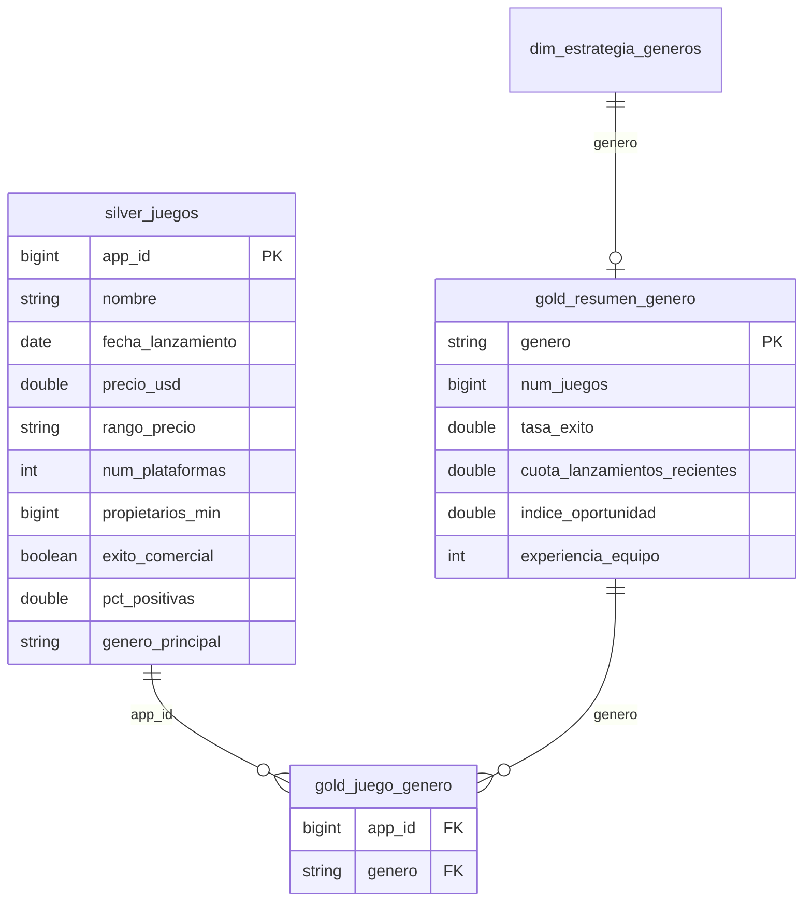

Para los análisis hemos usado estas definiciones:

- **Éxito comercial:** que el juego tenga como mínimo 100.000 propietarios estimados, es decir, que
  esté en el rango 100.000-200.000 o en uno superior.
- **Porcentaje de reseñas positivas:** positivas / (positivas + negativas). Solo lo calculamos si el
  juego tiene al menos 10 reseñas, porque con menos el porcentaje no dice mucho.
- **Índice de oportunidad de un género:** tasa de éxito del género dividida entre su cuota de
  lanzamientos en 2023-2025. Si sale alto, el género tiene bastante éxito en proporción a la
  competencia que hay ahora mismo.

---

## 3. Arquitectura

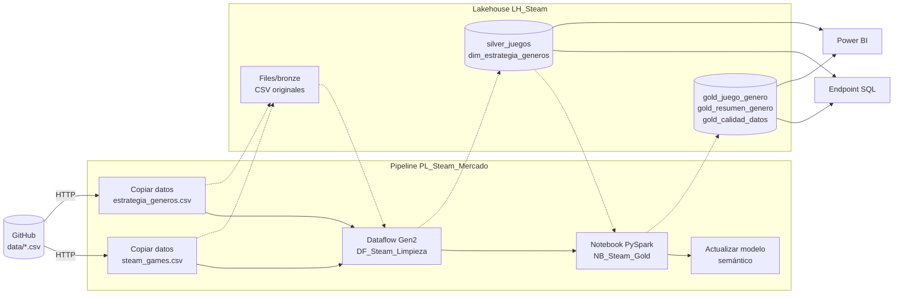

Hemos organizado el Lakehouse en tres capas (lo que se suele llamar arquitectura medallion):

- **Bronze:** carpeta `Files/bronze`, con los CSV tal y como llegan. Así siempre tenemos el dato
  original por si hay que revisar algo.
- **Silver:** tablas `silver_juegos` y `dim_estrategia_generos`, ya limpias, con tipos correctos y
  cruzadas entre sí.
- **Gold:** tablas `gold_*` con los datos agregados que usa el cuadro de mando y el control de calidad.

Los componentes que usamos y el motivo:

- **Lakehouse.** Permite guardar a la vez ficheros (la capa bronze) y tablas Delta (silver y gold).
  Además crea automáticamente un endpoint SQL y Power BI puede leer las tablas en modo Direct Lake
  sin copiarlas.
- **Pipeline.** Ejecuta todo en el orden correcto, se puede programar y guarda un historial de cada
  ejecución con su duración y los errores si los hay.
- **Dataflow Gen2.** Lo usamos para la limpieza porque con Power Query cada transformación queda como
  un paso que se puede revisar uno a uno.
- **Notebook PySpark.** Algunas cosas eran más cómodas en Spark que en Power Query: separar la lista
  de géneros en filas, calcular medianas por género o comparar el CSV original con la tabla limpia.
- **Endpoint SQL.** Para contestar las preguntas de negocio con consultas sin mover los datos.
- **Power BI.** Para el cuadro de mando, conectado en Direct Lake a las tablas del Lakehouse.

---

## 4. Desarrollo paso a paso

### 4.0 Preparación de los datos

Antes de entrar en Fabric hay que generar los CSV a partir del dataset de Kaggle:

```
python scripts/01_preparar_dataset.py games.csv data
```

Después subimos la carpeta `data` a un repositorio público de GitHub. Así el pipeline puede
descargar los ficheros directamente por HTTP con una URL de este tipo:

```
https://raw.githubusercontent.com/ofernandezr29/steam-fabric-mercado/main/data/steam_games.csv
```

Resultado esperado: `steam_games.csv` con 127.742 filas (28,7 MB) y `estrategia_generos.csv` con 12.

Para saber qué resultados teníamos que obtener en Fabric, programamos la misma lógica de limpieza en
pandas (`scripts/02_validar_local.py`). Las cifras de los apartados "Resultado esperado" salen de
ahí, y nos sirvieron para comprobar que cada paso en Fabric estaba bien hecho.

### 4.1 Crear el área de trabajo

1. Entrar en https://app.fabric.microsoft.com con la cuenta de la universidad.
2. En el menú de la izquierda, ir a *Áreas de trabajo* y pulsar *Nueva área de trabajo*.
3. Poner como nombre `WS_Steam_Mercado`. En *Avanzado* > *Modo de licencia* elegir *Prueba* (o la
   capacidad de Fabric de la universidad).
4. Pulsar *Aplicar*.

Resultado esperado: un área de trabajo con el icono de capacidad Fabric. En la figura 1 se ve ya con todos los elementos que se crean en los pasos siguientes.

<div class="fig">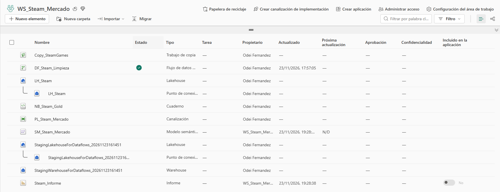<p class="pie">Figura 1. Área de trabajo WS_Steam_Mercado con los elementos del proyecto</p></div>

### 4.2 Crear el Lakehouse

1. Dentro del área de trabajo, *Nuevo elemento* > *Lakehouse*.
2. Nombre: `LH_Steam`. Dejamos marcada la opción *Lakehouse schemas*, así que las tablas se guardan
   dentro del esquema `dbo`. Pulsar *Crear*.
3. En el explorador de la izquierda, en los tres puntos de *Files*, elegir *Nueva subcarpeta* y
   crear la carpeta `bronze`.

<div class="fig">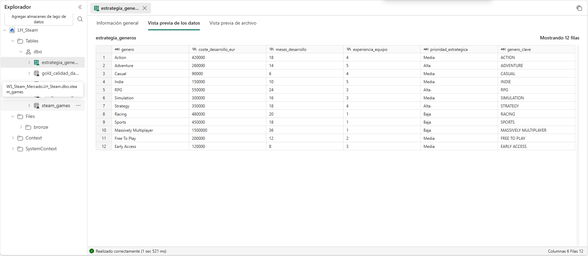<p class="pie">Figura 2. Lakehouse LH_Steam con las tablas en Tables/dbo y la carpeta Files/bronze. A la derecha, vista previa de la tabla de estrategia por género</p></div>

Resultado esperado: el Lakehouse con la carpeta `Files/bronze`. Fabric crea también el endpoint
SQL con el mismo nombre. Las tablas de la figura aparecen después de ejecutar el Dataflow y el notebook.

### 4.3 Dataflow Gen2 (DF_Steam_Limpieza)

Para poder crear el Dataflow tienen que estar ya los CSV en `Files/bronze`. La primera vez los
subimos a mano (tres puntos de la carpeta bronze > *Cargar* > *Cargar archivos*). También se puede
crear primero el pipeline del apartado 4.5 solo con las dos copias y ejecutarlo.

1. *Nuevo elemento* > *Dataflow Gen2*, con nombre `DF_Steam_Limpieza`.
2. Primera consulta, `estrategia_generos`:
    1. *Obtener datos* > *Lakehouse* > `LH_Steam` > *Files* > `bronze` > `estrategia_generos.csv`.
       Fabric genera solo los pasos de navegación hasta el fichero.
    2. Cambiar el nombre de la consulta a `estrategia_generos` en el panel de configuración de la derecha.
    3. Abrir *Inicio* > *Editor avanzado* y pegar el código de `fabric/dataflow/01_estrategia_generos.pq`.
       La línea `Binario = Web.Contents(...)` se sustituye por los pasos de navegación que había
       generado Fabric, de forma que el último paso se llame `Binario` y devuelva el fichero. Si se
       prefiere, se puede dejar `Web.Contents` y leer directamente de GitHub.
3. Segunda consulta, `silver_juegos`: lo mismo con `steam_games.csv` y el código de
   `fabric/dataflow/02_silver_juegos.pq`.
4. En la vista de diagrama se ve que `silver_juegos` depende de `estrategia_generos`, porque hace un
   cruce con ella.

<div class="fig">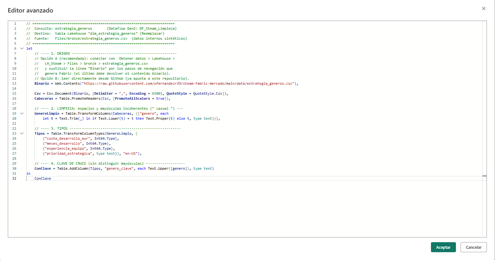<p class="pie">Figura 3. Editor avanzado con el código M de la consulta estrategia_generos</p></div>

<div class="fig">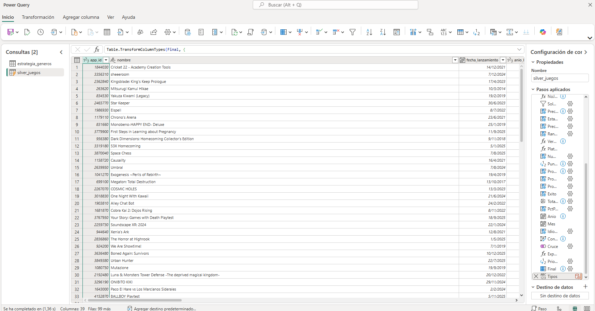<p class="pie">Figura 4. Consulta silver_juegos en el editor de Power Query, con la lista de pasos aplicados a la derecha</p></div>

<div class="fig">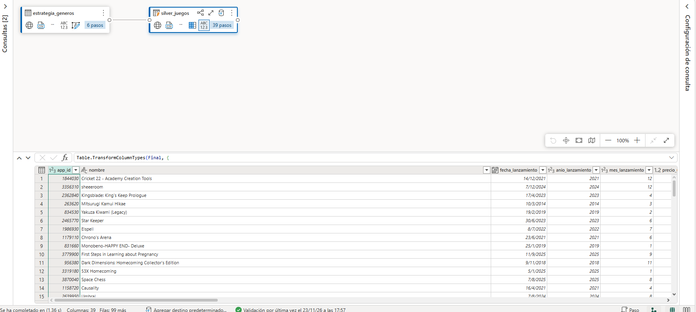<p class="pie">Figura 5. Vista de diagrama del Dataflow: silver_juegos depende de estrategia_generos por el cruce</p></div>

Las transformaciones, en el orden en que aparecen en el código:

| Paso | Qué hace | Por qué |
|---|---|---|
| 2 | Renombra las columnas en español y sin espacios | Los nombres con espacios dan problemas en Delta y en SQL |
| 3 | Quita espacios y convierte los textos vacíos en nulos | Una editora con un espacio delante contaría como otra distinta |
| 4 | Elimina las filas sin nombre | Un juego sin nombre no se puede identificar |
| 5 | Convierte a número con la cultura en-US | El CSV usa punto decimal; con la configuración española 5.24 se leería como 524 |
| 6 | Elimina duplicados por `app_id` | Si no, los duplicados inflan todos los recuentos |
| 7 | Convierte la fecha probando tres formatos | En el fichero hay `Aug 1, 2023`, `2023-08-01` y `Aug 2023` |
| 8 | Filtra fechas vacías o posteriores a 2026 | Son fechas imposibles y estropean la serie temporal |
| 9 | Rellena los géneros vacíos y calcula el género principal | Indie, Early Access y Free To Play no dicen qué tipo de juego es, así que se salta a la siguiente etiqueta |
| 10 | Quita los programas que no son juegos | El análisis es solo de videojuegos |
| 11 | Crea `estado_precio`, `precio_usd` y `rango_precio` | Los precios vacíos o imposibles no deben entrar en las medias, pero la fila sí sirve para el resto |
| 12 | Normaliza Windows, Mac y Linux a verdadero/falso | `TRUE`, `1` o `yes` significan lo mismo |
| 13 | Cambia las puntuaciones 0 por nulo | Un 0 en Metacritic significa que no hay nota, no que la nota sea 0 |
| 14 | Separa el rango de propietarios y calcula `exito_comercial` | Con el rango como texto no se puede hacer ningún cálculo |
| 15 | Calcula el total de reseñas y el porcentaje de positivas | Es nuestra medida de satisfacción |
| 16 | Añade año, mes y número de idiomas | Para el análisis por fechas (P4) |
| 17 | Cruza con `estrategia_generos` | Junta los datos de mercado con los datos internos del estudio |
| 18 | Selecciona las columnas finales y fija los tipos | El destino en el Lakehouse necesita tipos definidos |

5. Configurar el destino: con `silver_juegos` seleccionada, abajo a la derecha en *Destino de datos*
   elegir *Lakehouse* > `LH_Steam` > *Nueva tabla* con nombre `silver_juegos` y método de
   actualización *Reemplazar*. Comprobar la asignación de columnas y guardar. Repetir con
   `estrategia_generos`, que se guarda como `dim_estrategia_generos`.
6. Guardar y ejecutar el Dataflow y esperar a que termine.

Resultado esperado, con las filas que quedan después de cada etapa:

| Etapa | Filas |
|---|---|
| CSV original | 127.742 |
| Sin nombres vacíos | 127.487 |
| Sin duplicados | 125.603 |
| Con fecha válida | 125.478 |
| Sin programas que no son juegos (tabla `silver_juegos`) | 123.919 |

En la columna `estado_precio` deberían salir 122.311 filas "OK", 1.240 "Nulo" y 368 "Fuera de rango".

### 4.4 Notebook PySpark (NB_Steam_Gold)

1. En el área de trabajo, *Importar* > *Notebook* > *Desde este equipo* y elegir
   `fabric/notebooks/NB_Steam_Gold.ipynb`.
2. Al abrirlo, en el explorador de la izquierda, *Agregar lakehouse* > *Lakehouse existente* >
   `LH_Steam`. Queda como lakehouse predeterminado del notebook.
3. Comprobar que la segunda celda está marcada como celda de parámetros (en los tres puntos de la
   celda, *Alternar celda de parámetros*). Así el pipeline puede cambiar los años.
4. *Ejecutar todo*.

El notebook crea tres tablas:

- `gold_juego_genero`: una fila por cada juego y cada uno de sus géneros. Hace falta porque un juego
  puede tener varios géneros y queríamos poder filtrar por cualquiera de ellos en Power BI.
- `gold_resumen_genero`: número de juegos, tasa de éxito, porcentaje de reseñas positivas, precio
  medio, cuota de lanzamientos recientes e índice de oportunidad por género. Al final se cruza con los
  datos internos del estudio.
- `gold_calidad_datos`: cuenta los problemas de calidad que había en el CSV original para que quede
  constancia de lo que se ha corregido.

<div class="fig">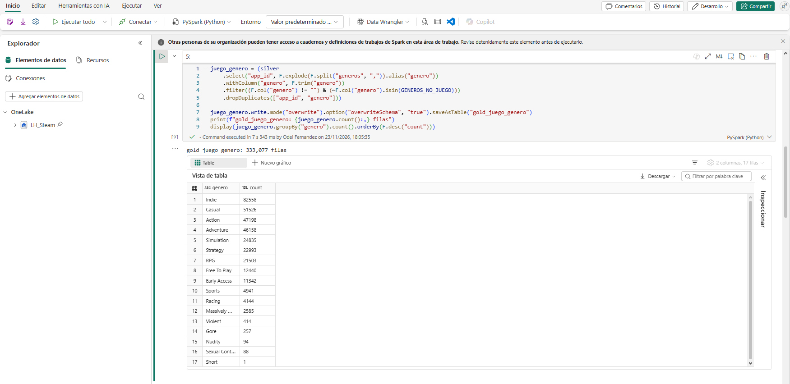<p class="pie">Figura 6. Celda del notebook que crea gold_juego_genero (333.077 filas) y número de juegos por género</p></div>

<div class="fig">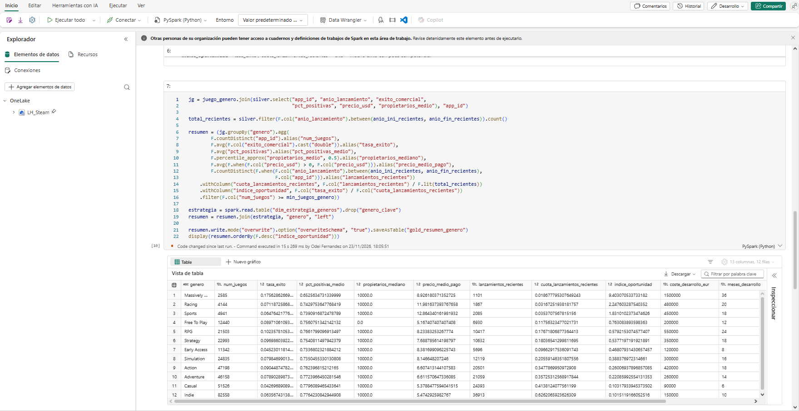<p class="pie">Figura 7. Celda del notebook que crea gold_resumen_genero, ordenada por índice de oportunidad</p></div>

Resultado esperado: `gold_resumen_genero` con 12 géneros (solo los que tienen al menos 500 juegos) y
`gold_calidad_datos` con estos valores:

| Métrica | Valor |
|---|---|
| Filas en el CSV original | 127.742 |
| Registros duplicados | 1.887 |
| Juegos sin nombre | 255 |
| Precio vacío | 1.286 |
| Precio fuera de rango | 380 |
| Fecha en formato ISO | 3.837 |
| Fecha posterior a 2026 | 126 |
| Booleano Mac/Linux mal escrito | 12.469 |
| Filas en silver | 123.919 |

### 4.5 Pipeline (PL_Steam_Mercado)

1. *Nuevo elemento* > *Canalización de datos*, con nombre `PL_Steam_Mercado`.
2. Primera actividad, *Copiar datos* (`Copy_SteamGames`):
    - Origen: nueva conexión de tipo *HTTP*, con URL base `https://raw.githubusercontent.com/` y
      autenticación anónima. URL relativa: `ofernandezr29/steam-fabric-mercado/main/data/steam_games.csv`.
      Formato: *Binario*.
    - Destino: *Lakehouse* `LH_Steam`, carpeta raíz *Files*, ruta `bronze`, nombre de archivo
      `steam_games.csv` y formato *Binario*.
3. Segunda actividad, otra *Copiar datos* (`Copy_Estrategia`) igual pero con `estrategia_generos.csv`.
4. Tercera actividad, *Flujo de datos* (`Dataflow_Limpieza`), con el Dataflow `DF_Steam_Limpieza`.
   La unimos con las dos copias usando la salida *Al completarse correctamente*, para que no empiece
   hasta que estén los dos ficheros.
5. Cuarta actividad, *Notebook* (`Notebook_Gold`), con `NB_Steam_Gold`. En *Parámetros base* se
   pueden pasar `anio_ini_recientes` y `anio_fin_recientes`. Se une con el Dataflow también por la
   salida de éxito.
6. Quinta actividad, *Actualización del modelo semántico* (`Refresh_Modelo`), con `SM_Steam_Mercado`
   (el modelo se crea en el apartado 4.7, así que esta actividad se añade después). Va unida al notebook.
7. Opcionalmente se puede añadir una actividad de Outlook o Teams conectada a la salida *Al producirse
   un error* del Dataflow y del notebook, para que avise si algo falla.
8. *Validar*, *Guardar* y *Ejecutar*.
9. Programarlo en *Inicio* > *Programación*: ejecución diaria a las 6:00.

<div class="fig">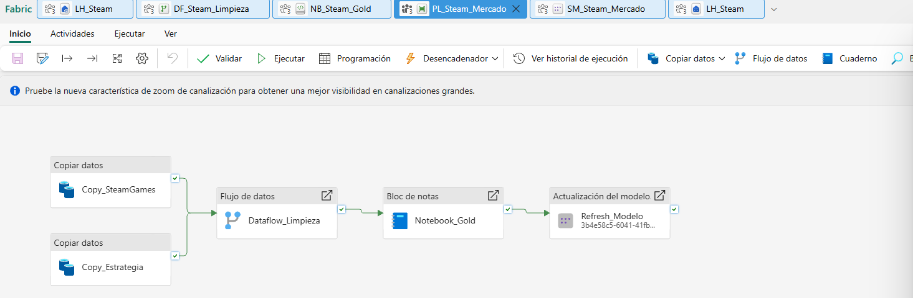<p class="pie">Figura 8. Pipeline PL_Steam_Mercado con las cinco actividades conectadas</p></div>

**[Figura 9. Programación del pipeline]**

Resultado esperado: todas las actividades terminan correctamente en unos minutos y las tablas del
Lakehouse se vuelven a crear con los mismos recuentos de los apartados 4.3 y 4.4.

### 4.6 Consultas SQL

Desde el Lakehouse, en el desplegable de arriba a la derecha se cambia a *Punto de conexión de
análisis SQL*. Ahí se abre una *Nueva consulta SQL* y se ejecutan las consultas del fichero
`fabric/sql/preguntas_negocio.sql`.

#### P1. Géneros

<div class="fig">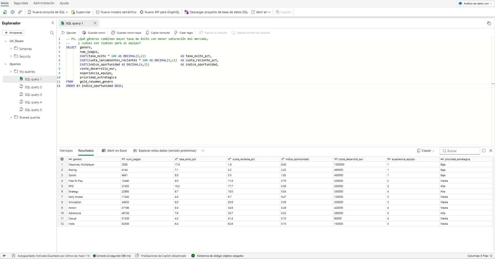<p class="pie">Figura 10. Consulta P1 en el punto de conexión SQL</p></div>

| Género | Juegos | Tasa de éxito | Cuota lanzamientos 2023-25 | Índice | Experiencia equipo | Prioridad |
|---|---|---|---|---|---|---|
| Massively Multiplayer | 2.585 | 17,6 % | 1,9 % | 9,40 | 1 | Baja |
| Racing | 4.144 | 7,1 % | 3,2 % | 2,25 | 1 | Baja |
| Sports | 4.941 | 6,5 % | 3,5 % | 1,83 | 1 | Baja |
| Free To Play | 12.440 | 9,0 % | 11,8 % | 0,76 | 2 | Media |
| RPG | 21.503 | 10,2 % | 17,7 % | 0,58 | 3 | Alta |
| Strategy | 22.993 | 9,7 % | 18,0 % | 0,54 | 4 | Alta |
| Early Access | 11.342 | 4,5 % | 9,7 % | 0,47 | 3 | Media |
| Simulation | 24.835 | 8,0 % | 20,6 % | 0,39 | 3 | Media |
| Action | 47.198 | 9,0 % | 34,8 % | 0,26 | 4 | Media |
| Adventure | 46.158 | 7,9 % | 35,7 % | 0,22 | 5 | Alta |
| Casual | 51.526 | 4,3 % | 41,4 % | 0,10 | 4 | Media |
| Indie | 82.558 | 6,4 % | 62,6 % | 0,10 | 5 | Media |

Si solo miramos el índice, los mejores géneros serían los multijugador masivos, las carreras y los
deportes. Aquí es donde se nota la utilidad de cruzar con los datos internos: son justo los géneros
en los que el equipo no tiene experiencia, y un MMO costaría alrededor de 1,5 millones y tres años,
así que no es realista. Entre los géneros con prioridad alta, estrategia y RPG son los que salen
mejor. Estrategia además encaja con la experiencia del equipo (4 sobre 5) y con el presupuesto
(unos 350.000 euros y 18 meses). La aventura, que es lo que ha hecho el estudio hasta ahora, está
bastante saturada.

#### P2. Precio

<div class="fig">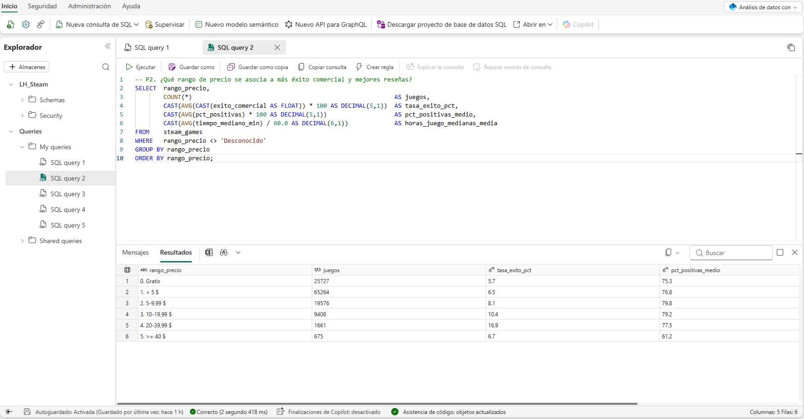<p class="pie">Figura 11. Consulta P2</p></div>

| Rango de precio | Juegos | Tasa de éxito | % reseñas positivas |
|---|---|---|---|
| Gratis | 25.727 | 5,7 % | 75,3 % |
| Menos de 5 $ | 65.264 | 6,5 % | 76,8 % |
| 5 a 9,99 $ | 19.576 | 8,1 % | 79,8 % |
| 10 a 19,99 $ | 9.408 | 10,4 % | 79,2 % |
| 20 a 39,99 $ | 1.661 | 16,9 % | 77,5 % |
| 40 $ o más | 675 | 6,7 % | 61,2 % |

La tasa de éxito sube con el precio hasta la franja de 20 a 40 dólares. Seguramente se debe a que
los juegos más caros suelen tener más presupuesto detrás, no a que el precio en sí atraiga más
compradores. A partir de 40 dólares el éxito baja y las reseñas empeoran mucho. Para un juego como
el que plantea el estudio, un precio de entre 15 y 25 dólares parece lo más razonable.

#### P3. Plataformas

<div class="fig">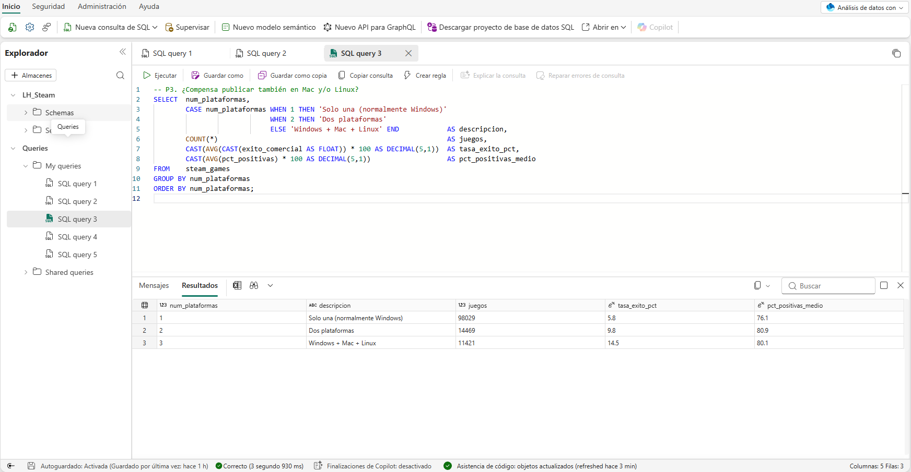<p class="pie">Figura 12. Consulta P3</p></div>

| Plataformas | Juegos | Tasa de éxito | % reseñas positivas |
|---|---|---|---|
| Una | 98.029 | 5,8 % | 76,1 % |
| Dos | 14.469 | 9,8 % | 80,9 % |
| Windows, Mac y Linux | 11.421 | 14,5 % | 80,1 % |

Los juegos que salen en las tres plataformas tienen una tasa de éxito unas 2,5 veces mayor que los
que solo salen en una. Hay que tener cuidado al interpretarlo, porque también puede ser que los
estudios con más recursos sean los que hacen las versiones para Mac y Linux. Aun así, es un argumento
a favor de incluir el port en el presupuesto.

#### P4. Saturación y mes de lanzamiento

<div class="fig">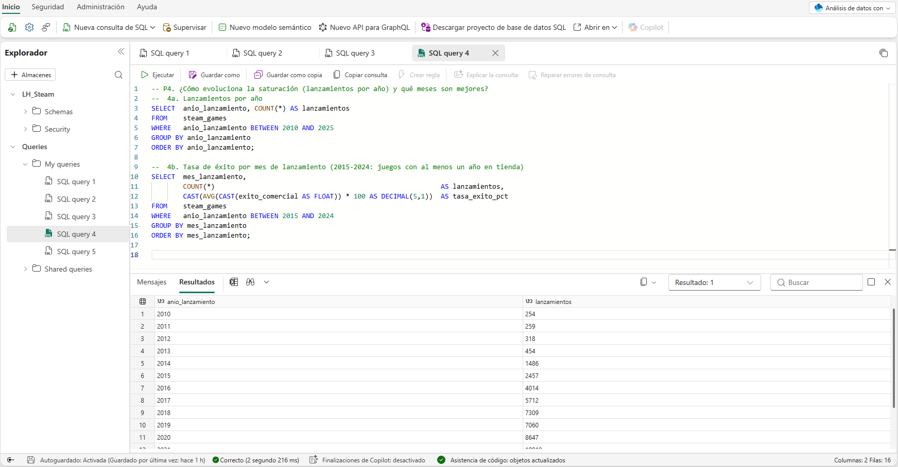<p class="pie">Figura 13. Consulta P4, lanzamientos por año y tasa de éxito por mes</p></div>

El número de lanzamientos no ha parado de crecer: 7.060 en 2019, 10.910 en 2021, 14.423 en 2023,
19.825 en 2024 y 24.699 en 2025.

Para ver el mes de lanzamiento usamos solo los juegos de 2015 a 2024, porque los de 2025 y 2026
todavía no han tenido tiempo de llegar a los 100.000 propietarios. Los mejores meses salen abril
(8,2 %), septiembre (8,1 %) y marzo (8,0 %). Los peores son diciembre (5,9 %) y noviembre (6,5 %),
probablemente porque coinciden con los lanzamientos grandes de final de año.

### 4.7 Modelo semántico y cuadro de mando

1. Desde el Lakehouse, *Nuevo modelo semántico*, con nombre `SM_Steam_Mercado`. Seleccionamos las
   tablas `silver_juegos`, `gold_juego_genero`, `gold_resumen_genero` y `gold_calidad_datos`. El modelo
   queda en modo Direct Lake, es decir, lee directamente las tablas Delta sin importarlas.
2. En *Abrir modelo de datos* creamos las relaciones arrastrando las columnas:
    - `gold_juego_genero[app_id]` con `silver_juegos[app_id]`, de varios a uno y con dirección de
      filtro en ambos sentidos.
    - `gold_juego_genero[genero]` con `gold_resumen_genero[genero]`, de varios a uno.

   La dirección en ambos sentidos hace falta para que al filtrar por género se filtren también los
   juegos de `silver_juegos`.
3. Creamos las medidas DAX que están en `fabric/powerbi/medidas_dax.md` (*Nueva medida*) y les damos
   formato (porcentaje con un decimal, dólares con dos decimales, etc.).
4. Creamos un informe nuevo a partir del modelo.

**[Figura 14. Vista del modelo con las relaciones]**

El informe tiene tres páginas.

**Página 1, "Mercado Steam".** Arriba, cuatro tarjetas con los KPI: juegos analizados, tasa de éxito,
porcentaje de reseñas positivas y precio medio de los juegos de pago. Debajo, cuatro gráficos:

- Columnas y línea con los lanzamientos por año y la tasa de éxito (P4).
- Barras con la tasa de éxito por rango de precio (P2).
- Columnas con la tasa de éxito y las reseñas positivas según el número de plataformas (P3).
- Columnas con la tasa de éxito por mes de lanzamiento (P4).

En el lateral pusimos tres segmentaciones: género (`gold_resumen_genero[genero]`), año de lanzamiento
(control deslizante) y prioridad estratégica.

**Página 2, "Oportunidad por género".** Un gráfico de dispersión con la cuota de lanzamientos
recientes en el eje X, la tasa de éxito en el eje Y, el número de juegos como tamaño de la burbuja y
la prioridad estratégica como color. Al lado, una tabla con el índice de oportunidad, el coste, los
meses de desarrollo y la experiencia del equipo por género, con barras de formato condicional en el
índice (P1).

**Página 3, "Calidad de datos".** Una tabla con `gold_calidad_datos` para que se vea qué se ha
corregido en los datos.

En todos los gráficos pusimos un título que dice qué pregunta responde, las unidades en los ejes y
los mismos colores en todo el informe.

<div class="fig">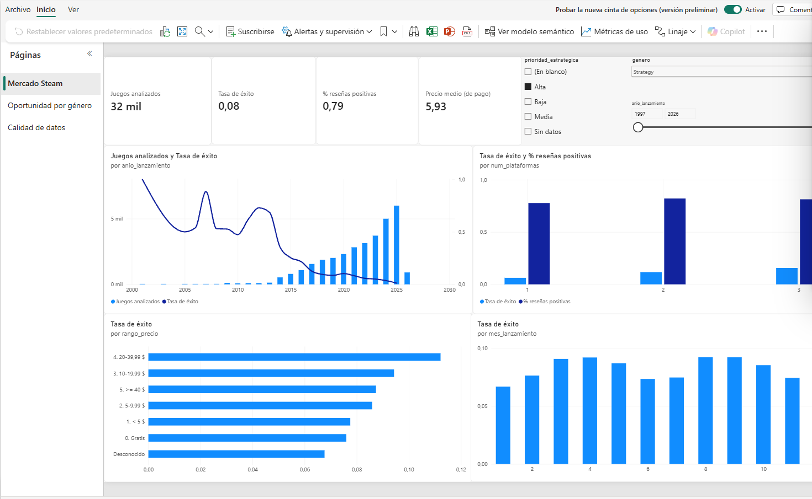<p class="pie">Figura 15. Página "Mercado Steam" filtrada por el género Strategy y prioridad alta, para mostrar cómo responden los gráficos a las segmentaciones</p></div>

<div class="fig">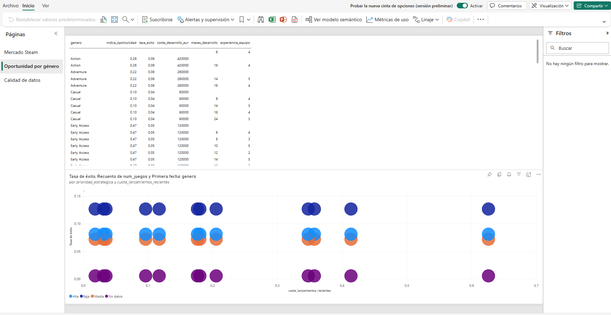<p class="pie">Figura 16. Página "Oportunidad por género"</p></div>

<div class="fig">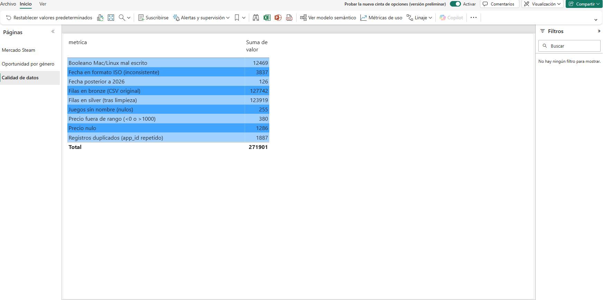<p class="pie">Figura 17. Página "Calidad de datos"</p></div>

### 4.8 Compartir el área de trabajo

En el área de trabajo, *Administrar acceso* > *Agregar personas o grupos*, escribir el correo de la
profesora y darle el rol de *Lector* (o *Colaborador* si tiene que poder ejecutar el pipeline).

**[Figura 18. Panel de acceso al área de trabajo]**

---

## 5. Justificación del uso de Microsoft Fabric

**¿Qué aporta usar una plataforma cloud frente a hacerlo en local?**

Haciéndolo en local habría que instalar y mantener por separado una base de datos, un entorno con
Spark o Python y Power BI, y los datos acabarían copiados en varios sitios. En Fabric todos los
componentes trabajan sobre el mismo almacenamiento (OneLake), la capacidad de cálculo se ajusta a lo
que haga falta y cualquier persona del equipo puede acceder desde el navegador con sus permisos.
Para una empresa pequeña también es más barato pagar por uso que comprar hardware.

**¿Qué ventajas tiene el pipeline frente a ejecutar cada paso a mano?**

El pipeline asegura que los pasos se hacen siempre en el mismo orden, por ejemplo que el notebook no
empiece hasta que el Dataflow ha terminado bien. Se puede programar para que el cuadro de mando esté
actualizado cada mañana sin que nadie haga nada, guarda un historial de las ejecuciones y permite
configurar reintentos y avisos si falla algo. Además, cualquier persona del equipo puede volver a
lanzar el proceso completo sin saber cómo está hecho cada paso.

**¿Qué aporta el cuadro de mando a la organización?**

Resume más de 120.000 juegos en unas pocas respuestas concretas sobre género, precio, plataformas y
fecha de lanzamiento. Todo el comité ve los mismos datos y puede probar escenarios con los filtros,
por ejemplo mirar solo los géneros con prioridad alta o solo los juegos de los últimos cinco años.

**¿Cómo podría evolucionar la solución si aumentara el volumen de datos o la frecuencia?**

- Hacer cargas incrementales: copiar solo los juegos nuevos o modificados y usar `MERGE` sobre las
  tablas Delta en lugar de reemplazarlas enteras.
- Leer directamente de la API de Steam con un notebook, o usar Eventstream para datos casi en tiempo
  real como el número de jugadores conectados.
- Particionar las tablas por año y pasar la limpieza más pesada del Dataflow a Spark.
- Entrenar un modelo de machine learning en Fabric que estime la probabilidad de éxito de un juego a
  partir de su género, precio y plataformas.
- Pasar a un Warehouse si hiciera falta escribir con T-SQL o hubiera muchos usuarios a la vez.

---

## 6. Conclusiones

Con los resultados obtenidos, la recomendación para el estudio sería hacer un juego de estrategia
(o, como segunda opción, un RPG), con un precio de entre 15 y 25 dólares, disponible en Windows, Mac
y Linux y lanzado en marzo-abril o en septiembre, evitando noviembre y diciembre.

Hay algunas limitaciones que conviene tener en cuenta:

- Los propietarios son estimaciones por rangos de SteamSpy, no ventas reales.
- Los juegos más recientes todavía no han tenido tiempo de acumular propietarios, por eso parte del
  análisis se limita a 2015-2024.
- Las relaciones que hemos visto son correlaciones; no demuestran que, por ejemplo, salir en Linux
  cause más ventas.
- Los datos internos del estudio son inventados por nosotros.

---

## Anexo. Ficheros del proyecto

| Ruta | Contenido |
|---|---|
| `data/` | Datasets |
| `scripts/01_preparar_dataset.py` | Preparación del dataset y problemas de calidad añadidos |
| `scripts/02_validar_local.py` | La misma lógica en pandas, para comprobar resultados |
| `scripts/03_generar_notebook.py` | Genera el notebook |
| `scripts/04_exportar_pdf.py` | Genera los PDF de la documentación |
| `fabric/dataflow/*.pq` | Código Power Query M del Dataflow Gen2 |
| `fabric/notebooks/NB_Steam_Gold.ipynb` | Notebook PySpark |
| `fabric/sql/preguntas_negocio.sql` | Consultas SQL de las preguntas de negocio |
| `fabric/powerbi/medidas_dax.md` | Medidas DAX y relaciones del modelo |
