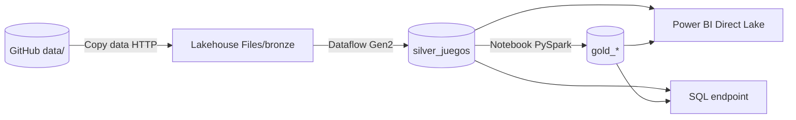

# Steam Market Intelligence · Microsoft Fabric

Proyecto de **Cloud Computing (curso 2026-2027)**: solución de análisis de datos en Microsoft Fabric
para que un estudio independiente de videojuegos (*Nébula Games*, ficticio) decida **qué género,
precio, plataformas y fecha** elegir para su próximo juego, a partir del catálogo completo de Steam.

📘 **Guía paso a paso / borrador del guion de laboratorio: [GUIA.md](GUIA.md)**

## Arquitectura



Todo orquestado por el pipeline `PL_Steam_Mercado` (2 copias → Dataflow → Notebook → refresco del modelo).

## Estructura

```
data/
  steam_games.csv                   dataset principal (127.742 filas, con problemas de calidad)
  estrategia_generos.csv            datos internos sintéticos del estudio
  registro_problemas_inyectados.csv qué se alteró y dónde
scripts/
  01_preparar_dataset.py            games.csv de Kaggle -> data/
  02_validar_local.py               réplica en pandas de la lógica (resultados esperados)
  03_generar_notebook.py            genera el .ipynb
fabric/
  dataflow/01_estrategia_generos.pq Power Query M (Dataflow Gen2)
  dataflow/02_silver_juegos.pq      Power Query M (Dataflow Gen2)
  notebooks/NB_Steam_Gold.ipynb     PySpark: capa gold + control de calidad
  sql/preguntas_negocio.sql         T-SQL de las 4 preguntas de negocio
  powerbi/medidas_dax.md            medidas DAX y relaciones
```

## Reproducir los datos

```bash
pip install pandas numpy
# games.csv: Steam Games Dataset (Kaggle)
python scripts/01_preparar_dataset.py ruta/a/games.csv data
python scripts/02_validar_local.py data
```

## Fuente de datos

*Steam Games Dataset* (Kaggle), recopilado de la API de Steam y SteamSpy. Se usa con fines educativos.
