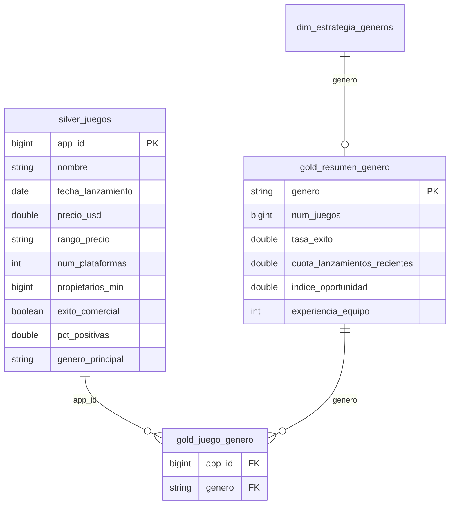

# Entregable 2 · Datasets

Proyecto de Cloud Computing (curso 2026-2027) · Inteligencia de mercado en Steam con Microsoft Fabric

Repositorio: https://github.com/ofernandezr29/steam-fabric-mercado

## 1. Ficheros, variables y calidad de datos

### 1.1 Fuentes

| Fichero | Origen | Tipo | Filas | Descripción |
|---|---|---|---|---|
| `data/steam_games.csv` | *Steam Games Dataset* (Kaggle, recopilado de la API de Steam y SteamSpy) | Público + problemas de calidad inyectados | 127.742 | Una fila por app de Steam |
| `data/estrategia_generos.csv` | Generado por el equipo (`scripts/01_preparar_dataset.py`) | Sintético | 12 | Datos internos de Nébula Games por género |
| `data/registro_problemas_inyectados.csv` | Generado por el script | Trazabilidad | 20.257 | Qué valor se alteró, en qué columna y de qué tipo |

El dataset original (`games.csv`, 400 MB) incluye descripciones, URLs de capturas y vídeos que no
aportan al caso de uso. El script `01_preparar_dataset.py` selecciona 24 columnas (≈ 29 MB).

### 1.2 Variables principales de `steam_games.csv`

| Columna | Tipo | Descripción |
|---|---|---|
| `AppID` | entero | Identificador de Steam (clave) |
| `Name` | texto | Nombre del juego |
| `Release date` | texto | Fecha de lanzamiento (`Aug 1, 2023`) |
| `Estimated owners` | texto | Rango de propietarios estimado (`20000 - 50000`) |
| `Price` | decimal | Precio en USD |
| `Windows`, `Mac`, `Linux` | booleano | Plataformas soportadas |
| `Positive`, `Negative` | entero | Número de reseñas positivas / negativas |
| `Metacritic score`, `User score` | entero | Puntuaciones (0 = sin puntuación) |
| `Average/Median playtime forever` | entero | Minutos jugados |
| `Developers`, `Publishers` | texto | Desarrolladora y editora |
| `Genres` | texto | Lista de géneros separados por comas |
| `Supported languages` | texto | Lista de idiomas (`['English', 'French']`) |

### 1.3 Variables de `estrategia_generos.csv` (sintético)

| Columna | Descripción |
|---|---|
| `genero` | Género de Steam (clave de cruce) |
| `coste_desarrollo_eur` | Coste medio estimado de desarrollo para el estudio |
| `meses_desarrollo` | Duración estimada del desarrollo |
| `experiencia_equipo` | Experiencia del equipo en el género (1 = ninguna, 5 = experto) |
| `prioridad_estrategica` | Prioridad fijada por dirección (Alta / Media / Baja) |

### 1.4 Problemas de calidad de datos

Además de los defectos **reales** del dataset, el script inyecta problemas de forma reproducible
(semilla 2627) para demostrar su tratamiento:

| Problema | Real / inyectado | Filas afectadas | Tratamiento (paso del Dataflow) |
|---|---|---|---|
| Cabecera con dos columnas fusionadas (`DiscountDLC count`) | Real | todo el fichero | Corregido en el script de preparación |
| Registros duplicados | Inyectado (1,5 %) | 1.887 | Quitar duplicados por `app_id` (paso 6) |
| `Name` nulo | Inyectado | 255 | Eliminar fila (paso 4) |
| `Price` nulo | Inyectado (1 %) | 1.286 | Marcar `estado_precio = "Nulo"` (paso 11) |
| `Price` negativo o > 1000 $ | Inyectado | 380 | Marcar "Fuera de rango" y dejar nulo (paso 11) |
| Fechas en formato ISO `2023-08-01` | Inyectado (3 %) | 3.837 | Parseo con varios formatos (paso 7) |
| Fechas posteriores a 2026 | Inyectado | 126 | Filtrar (paso 8) |
| Booleanos `TRUE/true/1/yes/Y` | Inyectado (5 %) | 12.469 | Normalizar a lógico (paso 12) |
| Espacios sobrantes en editores | Inyectado (2 %) | — | `Text.Trim` (paso 3) |
| Puntuaciones `0` que significan "sin dato" | Real | mayoría | Sustituir por nulo (paso 13) |
| Rango de propietarios como texto | Real | todas | Separar en mín./máx./medio (paso 14) |
| `Genres` nulo | Real | ≈ 8.400 | "Sin género" (paso 9) |
| Software que no es juego (Utilities, Video Production…) | Real | ≈ 1.500 | Filtrar (paso 10) |
| `" casual "` en el fichero interno | Inyectado | 1 | Trim + mayúsculas (consulta `estrategia_generos`) |

### 1.5 Modelo de datos resultante

**Definiciones clave**
- **Éxito comercial:** `propietarios_min ≥ 100.000` (el juego está como mínimo en el rango 100k–200k).
- **% reseñas positivas:** `positivas / (positivas + negativas)`, solo si hay ≥ 10 reseñas.
- **Índice de oportunidad (por género):** `tasa de éxito / cuota de lanzamientos 2023-2025`.
  Un valor alto indica mucho éxito con relativamente poca competencia reciente.

## 2. Procedimiento de generación

Los datos sintéticos y los problemas de calidad se generan con `01_preparar_dataset.py`
(incluido en esta carpeta). El proceso es reproducible gracias a una semilla fija (2627):

1. Descargar el *Steam Games Dataset* de Kaggle y descomprimir `games.csv`.
2. Instalar dependencias: `pip install pandas numpy`.
3. Ejecutar `python 01_preparar_dataset.py games.csv data`.

El script:

1. Corrige la cabecera original, que fusiona las columnas `Discount` y `DLC count` (39 nombres para 40 campos).
2. Selecciona las 24 columnas relevantes (de 400 MB a 28,7 MB).
3. Inyecta los problemas de calidad descritos en el apartado 1.4 y los registra en `registro_problemas_inyectados.csv`
   (columnas: `AppID`, `tipo`, `columna`, `valor_original`, `valor_inyectado`).
4. Genera `estrategia_generos.csv` con los datos internos sintéticos del estudio. Los valores de coste, duración,
   experiencia y prioridad son supuestos del equipo para un estudio independiente de 15 personas.
