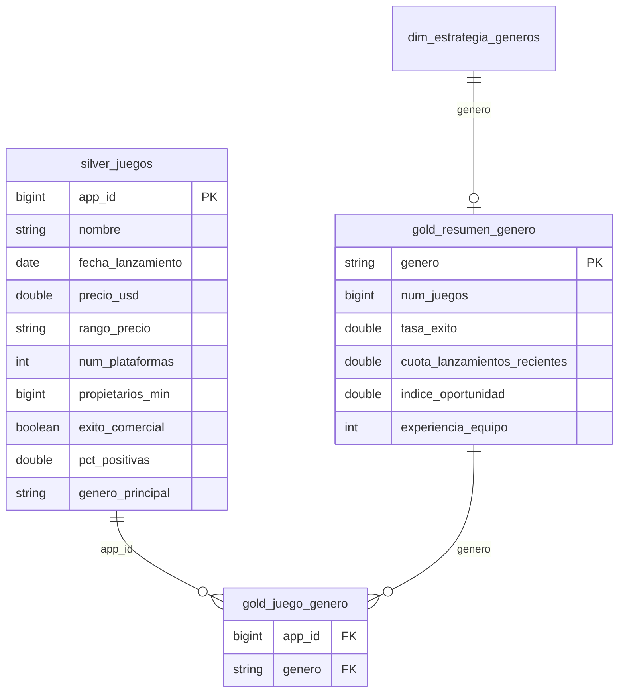

# Descripción de los datasets

**Análisis del mercado de videojuegos en Steam con Microsoft Fabric.** Curso 2026-2027

Autores: _Nombre 1_ y _Nombre 2_

## 1. Ficheros y variables

### 1.1 Origen de los datos

Hemos usado tres ficheros:

| Fichero | Origen | Filas | Contenido |
|---|---|---|---|
| `steam_games.csv` | Steam Games Dataset (Kaggle), obtenido de la API de Steam y de SteamSpy | 127.742 | Una fila por aplicación de Steam |
| `estrategia_generos.csv` | Sintético, generado por nosotros | 12 | Datos internos del estudio por género |
| `registro_problemas_inyectados.csv` | Generado por el script de preparación | 20.257 | Qué valores hemos alterado y en qué columna |

El fichero original de Kaggle (`games.csv`) ocupa unos 400 MB porque incluye las descripciones de
los juegos, enlaces a capturas y vídeos, etc. Como no lo necesitábamos y además GitHub no admite
ficheros de más de 100 MB, preparamos un script en Python (`01_preparar_dataset.py`) que se queda
con 24 columnas. El resultado ocupa unos 29 MB.

Al abrir el fichero original nos encontramos con que la cabecera tiene 39 nombres de columna pero
cada fila tiene 40 valores: las columnas `Discount` y `DLC count` aparecen juntas como
`DiscountDLC count`. Lo corregimos en el mismo script antes de hacer nada más.

### 1.2 Variables principales de steam_games.csv

| Columna | Tipo | Descripción |
|---|---|---|
| AppID | entero | Identificador del juego en Steam |
| Name | texto | Nombre |
| Release date | texto | Fecha de lanzamiento, con formato `Aug 1, 2023` |
| Estimated owners | texto | Rango estimado de propietarios, por ejemplo `20000 - 50000` |
| Price | decimal | Precio en dólares |
| Windows, Mac, Linux | booleano | Plataformas en las que está disponible |
| Positive, Negative | entero | Número de reseñas positivas y negativas |
| Metacritic score, User score | entero | Puntuaciones (un 0 significa que no tiene) |
| Average / Median playtime forever | entero | Minutos de juego medios y medianos |
| Developers, Publishers | texto | Desarrolladora y editora |
| Genres | texto | Lista de géneros separados por comas |
| Supported languages | texto | Lista de idiomas, por ejemplo `['English', 'French']` |

### 1.3 Datos internos (estrategia_generos.csv)

Este fichero simula la información que tendría el propio estudio. Los valores los hemos fijado
nosotros pensando en un estudio pequeño:

| Columna | Descripción |
|---|---|
| genero | Género de Steam, sirve para cruzarlo con el catálogo |
| coste_desarrollo_eur | Coste aproximado de desarrollar un juego de ese género |
| meses_desarrollo | Tiempo de desarrollo estimado |
| experiencia_equipo | Experiencia del equipo en ese género, de 1 (ninguna) a 5 |
| prioridad_estrategica | Prioridad que le da la dirección: Alta, Media o Baja |

### 1.4 Problemas de calidad

El enunciado pide que los datos tengan problemas de calidad para demostrar cómo se tratan. El
dataset ya traía algunos de origen, y otros los añadimos con el script de preparación usando una
semilla fija (2627) para que el resultado sea siempre el mismo. Todo lo que se modifica queda
apuntado en `registro_problemas_inyectados.csv`.

| Problema | Origen | Filas | Cómo se trata en el Dataflow |
|---|---|---|---|
| Registros duplicados | Añadido (1,5 %) | 1.887 | Se quitan duplicados por `app_id` (paso 6) |
| Nombre vacío | Añadido | 255 | Se elimina la fila (paso 4) |
| Precio vacío | Añadido (1 %) | 1.286 | Se marca como "Nulo" en `estado_precio` (paso 11) |
| Precio negativo o mayor de 1000 $ | Añadido | 380 | Se marca como "Fuera de rango" y no se usa en medias (paso 11) |
| Fechas en formato `2023-08-01` | Añadido (3 %) | 3.837 | Se prueban varios formatos de fecha (paso 7) |
| Fechas posteriores a 2026 | Añadido | 126 | Se filtran (paso 8) |
| Booleanos escritos como `TRUE`, `1`, `yes`, `Y`... | Añadido (5 %) | 12.469 | Se normalizan a verdadero/falso (paso 12) |
| Espacios de más en desarrolladora y editora | Añadido (2 %) | | `Text.Trim` (paso 3) |
| Puntuaciones a 0 que en realidad son "sin dato" | Original | | Se cambian por nulo (paso 13) |
| Propietarios como rango de texto | Original | Todas | Se separa en mínimo, máximo y valor medio (paso 14) |
| Géneros vacíos | Original | unas 8.400 | Se ponen como "Sin género" (paso 9) |
| Programas que no son juegos (Utilities, Video Production...) | Original | unas 1.500 | Se filtran (paso 10) |
| `" casual "` con espacios y en minúscula en el fichero interno | Añadido | 1 | Se limpia en la consulta `estrategia_generos` |

### 1.5 Modelo de datos

Después de la limpieza y del notebook, las tablas quedan relacionadas así:

Para los análisis hemos usado estas definiciones:

- **Éxito comercial:** que el juego tenga como mínimo 100.000 propietarios estimados, es decir, que
  esté en el rango 100.000-200.000 o en uno superior.
- **Porcentaje de reseñas positivas:** positivas / (positivas + negativas). Solo lo calculamos si el
  juego tiene al menos 10 reseñas, porque con menos el porcentaje no dice mucho.
- **Índice de oportunidad de un género:** tasa de éxito del género dividida entre su cuota de
  lanzamientos en 2023-2025. Si sale alto, el género tiene bastante éxito en proporción a la
  competencia que hay ahora mismo.

## 2. Cómo se generan los datos

Los tres ficheros se generan con el script `01_preparar_dataset.py`, que está en esta misma carpeta.
Como usa una semilla fija (2627), al ejecutarlo de nuevo se obtienen exactamente los mismos ficheros.

1. Descargar el Steam Games Dataset de Kaggle y descomprimir `games.csv`.
2. Instalar las librerías necesarias: `pip install pandas numpy`.
3. Ejecutar `python 01_preparar_dataset.py games.csv data`.

El script hace lo siguiente:

1. Corrige la cabecera del fichero original, en la que `Discount` y `DLC count` aparecen juntas.
2. Se queda con las 24 columnas que usamos.
3. Añade los problemas de calidad del apartado 1.4 y los guarda en `registro_problemas_inyectados.csv`,
   con las columnas `AppID`, `tipo`, `columna`, `valor_original` y `valor_inyectado`.
4. Crea `estrategia_generos.csv` con los datos internos del estudio. Los costes, plazos, experiencia
   y prioridades los hemos decidido nosotros pensando en un estudio independiente de unas 15 personas.
